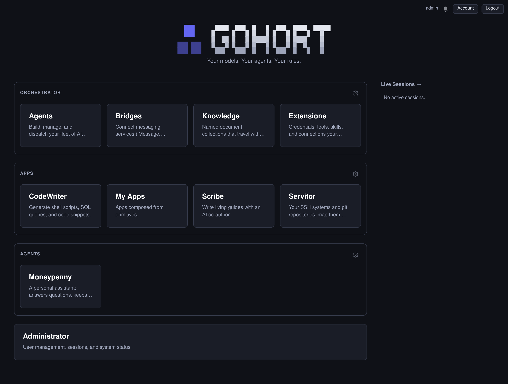
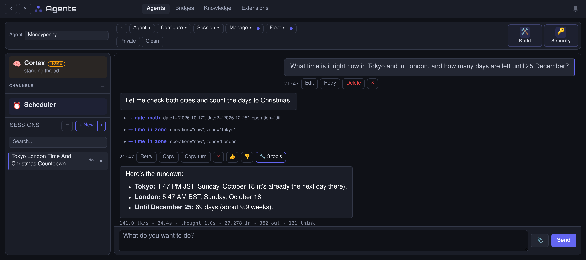
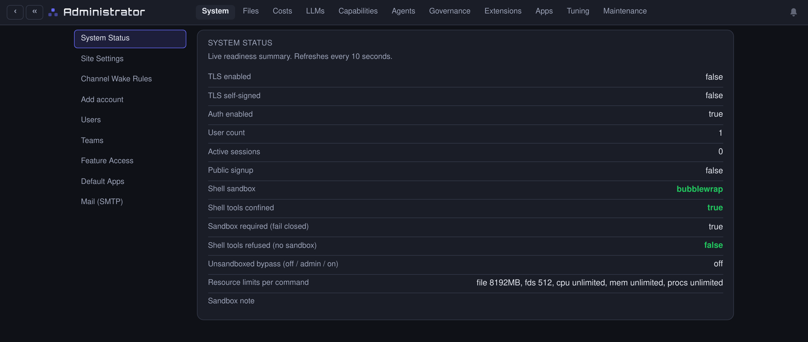

<p align="center">
  <picture>
    <source media="(prefers-color-scheme: dark)" srcset="docs/images/wordmark-dark.svg">
    <source media="(prefers-color-scheme: light)" srcset="docs/images/wordmark-light.svg">
    
  </picture>
</p>

<!-- The same logo as text, for anyone reading this file raw:

  ███      ███  ████  ████  █████  ███  ████
  ███     █   █ █   █ █   █     █ █   █ █   █
          █   █ █   █ █   █     █ █   █ ████
███ ███   █   █ █   █ █   █ █   █ █   █ █   █
███ ███    ███  ████  ████   ███   ███  ████

-->

# Gohort: Improvise, Adapt, Dispatch.

[](LICENSE)
[](https://go.dev)
[](#quick-start)
[](#1-the-harness)

**Your agent has agents. Hand it any technical job: it delegates to the specialist that owns it, and builds the tools, agents and apps it lacks. A local tier and a lead tier on one harness, a single Go binary, and the model is never handed a credential.**

<!-- Screenshots: take these from a FRESH deployment with demo data, never from a
     live instance: a real dashboard carries private app names, contacts and
     chat content, and a README image is in git history for good. Drop the files
     at the paths below and these render as-is. -->



You talk to one agent. It reads what you want and hands the job to the agent that owns that part, each with its own tools, its own memory, and the right to delegate further.

Tool selection degrades as the tool surface widens: an agent choosing among four relevant tools beats the same model choosing among forty, and the context it never loads is left for the work. A narrow job is also one a small model can do, which is why gohort runs well on local models. **Specialization and local-first are the same argument.**

```bash
make build && ./build/gohort --setup && ./build/gohort serve :8080
```

One static binary with no runtime to install, or [download a release](#download-a-release).

## Use it from Claude Desktop

Most MCP servers expose flat tools and leave the reasoning to the client. **gohort exposes agents as endpoints.** Claude Desktop talks to `servitor`, which investigates your machines over SSH in its own plan-driven loop under gohort's harness and returns a synthesized answer. So:

- **It remembers your systems** between sessions, because the memory belongs to the agent, not the chat.
- **gohort's loop governs the investigation** (round budget, loop-guard, failure-streak pivots), not the client's tool calling.
- **Credentials never reach the client.** They attach server-side, at call time.
- **The rounds of work run on your hardware**, and only the summary crosses the wire.

It also adds what desktop clients lack: tool sets scoped per workflow, separate memory per domain, and stages routed by sensitivity. gohort is where those are configured; Claude Desktop stays the client.

## What makes it different

### 1. The harness

Reliability comes from the loop, not the model. The model is told its round budget up front, a loop-guard stops a tool re-called with identical arguments after it errors three times, tool-round discipline prevents double replies, failure-streak detection changes the approach, and runs survive client disconnect.

**A frontier model and a local Qwen run on the same harness with no model-specific prompt branches**: nothing in the loop reads a model name. Where behaviour differs it is configuration (a no-think signal, a thinking budget), not a code path.

### 2. Credential isolation, where the model orchestrates and never holds

Keys are registered once and stored encrypted. They are injected **server-side at call time**, never rendered into a prompt. Every outbound call is checked against a base-URL and endpoint allowlist **before** the secret attaches. A universal rule forbids any agent from asking for one in chat. Shell work runs in a bubblewrap sandbox whose only network path is an audited hook, with `urllib` / `requests` / `curl` / `wget` refused at authoring time. On the normal paths, no prompt, tool result or chat message carries a credential.

There are two deliberate exceptions, granted per tool when the tool is approved:

- A tool can be given **raw network access**, for protocols the audited hook does not speak (psql, redis). A persistent shell always has it.
- A script can be handed a key outright, with a `secret:<name>` capability.

A tool with both can send that key anywhere its network reaches, and any script holding a key can print it into output the model reads. Approving such a tool is trusting it with the key. In a chat, such a tool asks the person watching before its first call, with the reason on the card ("It has raw network access"), and "Allow for this session" covers the rest of that conversation. A Private conversation cuts the network either way. A scheduled or unattended run does not stop for either: attaching the tool to the agent is the approval.

**Skills can carry tools**, and activating one lets its bundled scripts run. Skills are per-user and authored in-product rather than installed from a public registry, and what they bring runs inside the sandbox under the same credential allowlist as everything else.

There has been no external security review of this design. [SECURITY.md](SECURITY.md) has the trust model in full and how to report a problem privately.

### 3. Machines

A pipeline runs start to finish. A **machine** is a shape a *conversation* sits in across turns, where what an earlier step established is state rather than transcript to be re-read. See [the primitives](#the-primitives).

### 4. The router pattern

Because a step can narrow its own tools, a router agent can be built with **no capability except dispatch**.

**It runs local, cheaply.** Routing (classify, pick from a short list, little context) suits a small model, so the front door runs on your own GPU and only the specialist behind it needs to be expensive.

**It cannot be injected into doing anything.** A router with no tools has nothing to be turned against: the worst case is picking the wrong specialist, and that specialist has its own allowlist. In most systems the agent receiving untrusted input is the one holding every tool.

## Bringing your own keys

gohort registers credentials **per user**: each person brings their own API key, and no key is shared between accounts. Subscription OAuth tokens are not supported for programmatic use, only API keys.

Most providers' terms expect each end user to authenticate with their own credential, and treat subscription plans as individual use rather than a backend for automation. Check your provider's current terms, especially for scheduled or autonomous agents.

The same goes for MCP servers: where the administrator allows it (**Admin → Governance**), each person adds their own, signs in to them their own way, and their agents reach them with nobody else's account.

## A platform, and an SDK

**🏗️ A platform.** A web dashboard that runs a fleet: multi-agent dispatch with per-caller allowlists, declarative **pipelines**, **machines**, messaging **channels**, scheduled and event-triggered agents, multi-user auth with per-user data isolation, cross-user sharing, and cost telemetry.

**🧩 An SDK.** A Go framework you build on. Registering a new app is ~20 lines and one blank import; its CLI command and web dashboard are discovered from the type. Apps compose `FormPanel`, `Table`, `ChatPanel`, `PipelinePanel`, `ChipPicker` and the rest, and rarely touch HTML, CSS, or DOM JavaScript. A new app uses an existing primitive or adds a generic one.

## What it looks like in practice

You tell the Builder agent:

> *"Watch our status page and post to the team channel when it changes."*

It drafts an API credential for the status endpoint, authors a poll connector that checks it on a schedule, wires the result to a channel agent that speaks to your team's messaging service, and asks your admin for one approval, where the secret is pasted in. No code, no flow editor, no key pasted into a chat, and the model that assembled it cannot read the key.



## The primitives

- **One binary.** `make build` produces a single static executable (cgo off, so no libc floor): the web dashboard, the agent runtime, the database layer and every built-in app are compiled in. Deploying is copying one file; upgrading is replacing it.

- **Built in the browser.** The chat is the authoring surface. Tell the Builder agent "make me an agent for X" or "set up a workflow that does Y" and it assembles it from primitives: an agent, an attached pipeline, a skill, a runtime-defined tool. Anything consequential is saved through an admin approval queue.

- **Governed memory.** Each agent has several layers: always-in-prompt facts (with semantic dedup and supersession, so a changed fact replaces the stale one), vector reference memory, a graph of entities and relationships, a rewritable working-notes scratchpad, and conversation history that archives on compaction instead of collapsing into a summary. Every layer is toggled **per agent**, isolated **per (user, agent)**, and bounded by admin-tunable caps and a background prune. Since credentials are injected server-side, they do not land in memory on the normal paths.

- **Guardrails written as sentences.** Rules in plain language, set per agent or across the deployment, judged by a model on what comes in, before a consequential tool call, and before the reply goes out. A block carries its reason and lands in a fleet-wide log. An owner can make their agent fail closed when a check cannot reach a verdict, and the administrator's deployment rules are not the owner's to relax.

- **System Hooks: the jobs gohort hands to the host's tools.** Reading what arrives (PDFs, Word files, audio, video) and writing documents each have a native flow. Where the tool a flow wants is missing, an administrator adapts the job to a command the machine does have, tests it on a file, and turns it on, with ✨ Fix reading the program's own help and filling in the form. Flows run in the sandbox with no shell reading their commands, and what they hand back is checked before gohort uses it.

- **Local-first, not local-only.** By default the worker tier is your own GPU (Ollama / llama.cpp) and does the bulk of the work; an optional precision tier escalates to a frontier model for the stages that need it. Any stage can point at a hosted provider instead: fully local, fully hosted, or any mix. `ForcePrivate` agents and `Private:true` route stages are locked to the local tier, so sensitive data (credentials, internal docs, system facts) stays on the box.

- **Five primitives**: **agents** (persona + tools), **skills** (conditional prompt addendums with a self-training vector corpus), **collections** (RAG buckets), **pipelines** (declarative workflows that run start to finish), and **machines** (workflows a conversation stays in).

  A **pipeline** runs to an end: stages fan out for breadth, loop for depth, branch to stop or skip, and call tools directly for the deterministic parts, threading typed fields between each other. A `panel` stage puts several voices on one question in parallel, for as many rounds as you set, each round reading the last. A pipeline attaches to any agent as a callable tool, is a dispatch target of its own (with its own dispatch ACL), can be scheduled and shared, or becomes a page: a submit form whose fields are the run's parameters, the stages streaming in as each finishes, and every past run kept to re-read.

  A **machine** is a set of steps a conversation moves through and then stays in: work out what is being asked once, pick an approach once, then answer in that frame until the subject changes. What earlier steps established is **state, not transcript**, so turn eight does not re-read turn one's reasoning. A step can delegate to another agent, narrow its own tools, or be guarded so the conversation leaves when the job does. Pipelines and machines both have an editor with the workflow drawn above it (every box links to that step's form), a rehearsal or a real run on the page, and a "describe a change" box that redrafts from a sentence and can be undone.

  Any primitive exports as portable JSON. The recipe carries no identity, so it moves between deployments.

## Quick start

A local GPU (Ollama / llama.cpp) is optional: point the worker tier at a hosted provider instead if you'd rather.

### Download a release

Binaries for linux, macOS and Windows (amd64 and arm64 where the platform has both) are on the [releases page](https://github.com/cmcoffee/gohort/releases), each archive carrying the binary, `LICENSE`, `NOTICE` and the third-party notices for that build. No toolchain, no runtime, nothing to install beside it.

```bash
# Verify what you downloaded — SHA256SUMS sits beside the archives
sha256sum --ignore-missing -c SHA256SUMS     # macOS: shasum -a 256 -c SHA256SUMS

tar xzf gohort_<version>_linux_amd64.tar.gz
cd gohort_<version>_linux_amd64

./gohort --setup                     # TLS, listen addr, admin account (LLM + the rest: web UI)
./gohort serve 127.0.0.1:8080        # the web dashboard
```

On macOS the download is unsigned, so Gatekeeper quarantines it: `xattr -d com.apple.quarantine gohort` before the first run.

**On Windows, run the Linux build under WSL2.** Native Windows has no sandbox backend, and gohort refuses to run shell commands unconfined, so the Windows build runs chat, agents and every tool that needs no shell, but not shell commands, script tools or custom-app scripts. Under WSL2, unpack `gohort_<version>_linux_amd64.tar.gz` in your Linux home directory (not under `/mnt/c`), `sudo apt install bubblewrap`, and check with `./gohort --sandbox-doctor`: it should report `confined true`. On Ubuntu 23.10 and later, if bubblewrap is installed but `confined` is false, AppArmor is blocking it: `sudo sysctl -w kernel.apparmor_restrict_unprivileged_userns=0`.

### Build from source

**Requires:** Go 1.25+.

```bash
# Build — one static binary, plus the notices it has to travel with
make build

# First-boot setup (TLS, listen addr, admin account — the rest is configured in the web UI)
./build/gohort --setup

# Run the web dashboard (the primary surface)
./build/gohort serve :8080
./build/gohort serve :8443 --tls     # with a self-signed cert

./build/gohort --version
```

Then sign in and visit **/admin**: nearly all operator config (LLM routing, embeddings, STT, image gen, web search, SMTP, cost rates, tunables) lives there, each with an inline **Test connectivity** button.

**Do `--setup` first, and on loopback.** An instance with no users configured has nobody to authenticate, so the dashboard's front door is open and `/admin/` leads to the wizard that mints the first admin. That is how the first account gets created and it is fine on `127.0.0.1` (the setup default is `127.0.0.1:8181`); it is not fine on a public interface. Create the admin account, then widen the bind address.

**Optional host tools.** The binary needs nothing else to run, but a few features shell out to programs it expects on `PATH`: `ffmpeg`/`ffprobe` (audio and video), `pdftotext` and `pandoc` (document extraction), `yt-dlp` (video downloads), `git` (repository appliances), `python3` (sandboxed scripts), and `bwrap` (the shell sandbox, Linux). Each is optional and only the feature that uses it degrades when it is missing. **Admin → Capabilities → System Hooks** shows how each job is done on this machine, and adapts a job to another tool when the usual one is missing.

## Extend it: a whole app in ~20 lines

```go
package myapp

import . "github.com/cmcoffee/gohort/core"

func init() { RegisterApp(new(MyApp)) }

type MyApp struct {
    AppCore
}

func (T MyApp) Name() string         { return "myapp" }
func (T MyApp) Desc() string         { return "Does a thing." }
func (T MyApp) SystemPrompt() string { return "" }
func (T *MyApp) Init() error         { return T.Flags.Parse() }
func (T *MyApp) Main() error         { return nil }
```

Add `WebPath()` / `WebName()` / `WebDesc()` / `Routes()` and it gets a web dashboard automatically: the framework discovers it from the type. One blank import (`import _ ".../apps/myapp"`) is the only wiring. Start from the [`hello`](apps/hello/) scaffold and read [`core/ui/AUTHORING.md`](core/ui/AUTHORING.md).

## Built-in apps

| App | What it is |
|-----|-----------|
| `orchestrate` | **Agency**: the agent fleet runner. Chat with seed agents (Chat, Builder, Research, …) or your own; multi-layer governed per-(user, agent) memory, plan-driven authoring, sub-agent dispatch, attachable pipelines and machines |
| `admin` | Operator panel: users, permissions, app groups, API credentials, MCP servers, connectors, tool/skill curation, and all service config |
| `extensions` | What your agents draw on, in one place: credentials, tools, skills, connections, and your own MCP servers |
| `agents` | One published agent, one URL: a permission-gated chat surface scoped to a single agent |
| `knowledge` | Named document collections that travel with your skills, recalled by every agent that has those skills on |
| `filestore` | File stores: make a folder on this server searchable by an agent |
| `bridges` | Messaging transport: wire iMessage / Telegram / … to a channel agent, with a wake-rule gatekeeper |
| `servitor` | SSH system investigator + git-repo Q&A, plan-driven, with an xterm pane; systems are shareable |
| `scribe` | Living multi-section guides with an AI co-author: grounded in their sources, a Changes card on every turn with Undo, a header picture that can carry your logo |
| `publish` | Sends finished documents out to Confluence and other destinations, and keeps them updated |
| `codewriter` | Shell scripts, SQL queries and code snippets with an LLM co-editor |
| `monitor` | Live view of what every agent and app is doing right now, with Cancel beside each run |
| `mcpserver` | Expose gohort agents to an external MCP client (e.g. Claude Desktop) |
| `customapps` | Host for Builder-authored apps (the My Apps tile) at `/apps/<slug>/`: declarative sections (form, table, chart, chat, workbench, pipeline, or a raw HTML canvas), a per-app record store, sandboxed data/action scripts, schedules, and per-user sharing or an anonymous link |
| `hello` | Minimal scaffold for a new app |
| `openai_api` | OpenAI-compatible `/v1` endpoint: an external client drives a raw model tier or a full agent over the API shape it already speaks |
| `ollama_proxy` | Ollama-protocol proxy on its own port, for clients that speak only Ollama; lends the worker model as `gohort` |

Full descriptions in the [reference](docs/REFERENCE.md#built-in-apps).



## Companion client

**`gohort-desktop`**, a native Wails host (macOS): a viewer window plus an always-on menu-bar **Bridge** daemon that owns the host's OS permissions (filesystem, screenshot, contacts) and, on macOS, relays iMessage into the Bridges app. Its tool surface is expandable at runtime: the server can push an admin-approved, user-consented capability that lands as a new local tool without reshipping. See [`gohort-desktop/README.md`](gohort-desktop/README.md).

## Roadmap

- **Artifact marketplace**: every artifact type already exports as a portable, identity-free bundle; next is a remote catalog with signing and provenance, so a pipeline or agent recipe can move between deployments like a package.
- **Scoping parity across primitives**: collections and tools have per-user and shared tiers; skills are catching up.
- **Machines on dispatched turns**: a schedule firing, a delegation or a sub-agent call runs without the machine, because those paths have no session to hold a position in.

## Learn more

- **[docs/REFERENCE.md](docs/REFERENCE.md)**: the full feature surface, SDK interfaces, CLI flags, and project layout
- **[core/ui/AUTHORING.md](core/ui/AUTHORING.md)**: how to write a new app from scratch
- **[core/README.md](core/README.md)**: framework core types and internals
- **[docs/bridges-connector-contract.md](docs/bridges-connector-contract.md)**: writing a connector that relays a messaging service into Bridges
- **[SECURITY.md](SECURITY.md)**: the trust model, and how to report a vulnerability privately
- **[docs/design/](docs/design/)**: design records, one per feature: what it was built to do, the choices made, and what was left out

## License

Apache License 2.0: see [LICENSE](LICENSE) and [NOTICE](NOTICE).

Product names are used descriptively, to say what gohort interoperates with. Claude and Claude Desktop are trademarks of Anthropic, PBC; Ollama, llama.cpp and every other project named here belong to their respective owners. gohort is an independent project and is not affiliated with, endorsed by, or sponsored by any of them.

`make release` builds an export of `HEAD` for every supported platform with
`GOWORK=off`, and packages each binary with `LICENSE`, `NOTICE` and a
`THIRD_PARTY_NOTICES` generated for *that* platform from the modules actually
linked into it. Those three files are what a distributed binary has to carry.
A module that ships no license text of its own has its terms vendored under
[`licenses/`](licenses/), together with where they were obtained, and the
generated notices say so rather than passing them off as the module's own.

Versions before v0.6.314 were released under the MIT License and stay available
under those terms; the change applies from that version onward. Apache 2.0 was
chosen for its express patent grant, which MIT does not provide.

## Dependencies

The ten direct dependencies, from `go.mod`:

- [snugforge](https://github.com/cmcoffee/snugforge), logging, config, flags, kvlite database, concurrency primitives
- [go-pdf/fpdf](https://github.com/go-pdf/fpdf), PDF generation
- [go-rod/rod](https://github.com/go-rod/rod), the headless browser behind page rendering and browsing tools
- [go-shiori/go-readability](https://github.com/go-shiori/go-readability), article text out of a fetched page
- [gorilla/websocket](https://github.com/gorilla/websocket), Servitor's live terminal and the desktop bridge
- [rwcarlsen/goexif](https://github.com/rwcarlsen/goexif), a photo's EXIF (date, place, camera) handed to the vision model
- [golang.org/x](https://pkg.go.dev/golang.org/x) `crypto`, `image`, `net` and `sys`, the Go project's own extended libraries
