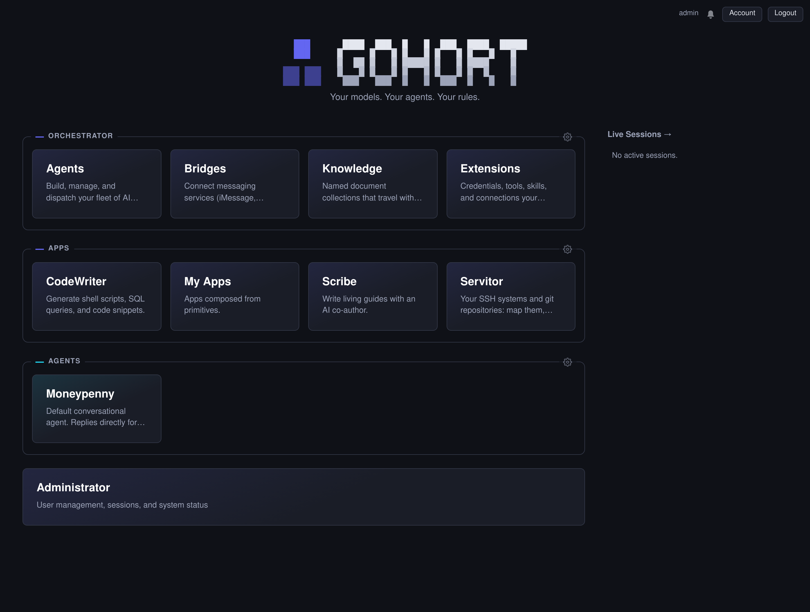
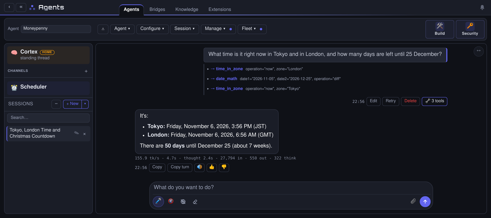
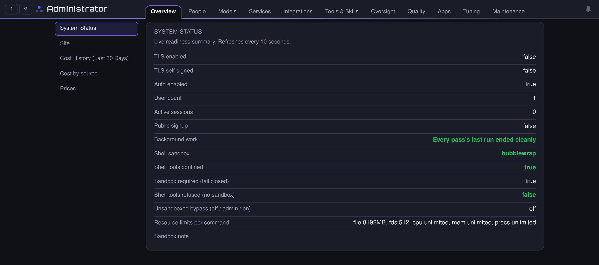

<p align="center">
  <picture>
    <source media="(prefers-color-scheme: dark)" srcset="docs/images/wordmark-dark.svg">
    <source media="(prefers-color-scheme: light)" srcset="docs/images/wordmark-light.svg">
    
  </picture>
</p>

<!-- The same logo as text, for anyone reading this file raw:

  ███      ███  ████  ████  █████  ███  ████
  ███     █   █ █   █ █   █     █ █   █ █   █
          █   █ █   █ █   █     █ █   █ ████
███ ███   █   █ █   █ █   █ █   █ █   █ █   █
███ ███    ███  ████  ████   ███   ███  ████

-->

# Gohort: Your models, your agents, your rules.

[](LICENSE)
[](https://go.dev)
[](#quick-start)
[](#1-the-harness)

**Your agent has agents. Hand it any technical job: it delegates to the specialist that owns it, and builds the tools, agents and apps it lacks. A local tier and a lead tier on one harness, a single Go binary, and the model is never handed a credential.**

<!-- Screenshots: take these from a FRESH deployment with demo data, never from a
     live instance: a real dashboard carries private app names, contacts and
     chat content, and a README image is in git history for good. Drop the files
     at the paths below and these render as-is. -->



You talk to one agent. It hands each job to the agent that owns it, which has its own tools and memory and can delegate further.

An agent choosing among four relevant tools beats the same model choosing among forty, and keeps the context it never loads for the work. A narrow job is also one a small model can do. **Specialization and local-first are the same argument.**

```bash
make build && ./build/gohort --setup && ./build/gohort serve :8080
```

One static binary with no runtime to install, or [download a release](#download-a-release).

## Use it from Claude Desktop

Most MCP servers expose flat tools and leave the reasoning to the client. **gohort exposes agents as endpoints.** Claude Desktop talks to `servitor`, which investigates your machines over SSH in its own plan-driven loop and returns a synthesized answer:

- **It remembers your systems** between sessions: the memory is the agent's, not the chat's.
- **gohort's loop runs the investigation** (round budget, loop-guard, failure-streak pivots), not the client's tool calling.
- **Credentials never reach the client.** They attach server-side, at call time.
- **The work runs on your hardware**; only the summary crosses the wire.

gohort also adds what desktop clients lack: tool sets scoped per workflow, memory per domain, and stages routed by sensitivity. Claude Desktop stays the client.

**Your apps are MCP servers too.** Each app has its own address, `/mcp/app/<slug>/`, whose tools are the actions, data sources and pipeline it marks `expose`, and a key can be limited to that app. The owner can offer it to the people the app is shared with: each makes their own key, and their calls run on their own records. An action that confirms first asks its question in the client, mid-call.

## What makes it different

### 1. The harness

Reliability comes from the loop, not the model. The model knows its round budget up front. A loop-guard stops a tool re-called with the same arguments after three errors, tool-round discipline prevents double replies, a failure streak changes the approach, and runs survive a client disconnect.

**A frontier model and a local Qwen run on the same harness with no model-specific prompt branches.** Nothing in the loop reads a model name; where models differ, it is configuration (a no-think signal, a thinking budget).

### 2. Credential isolation, where the model orchestrates and never holds

Keys are stored encrypted and injected **server-side at call time**, never into a prompt. Every outbound call is checked against an allowlist **before** the secret attaches. Shell work runs in a bubblewrap sandbox whose only network path is gohort's audited fetch hook. On the normal paths, no prompt, tool result or chat message carries a credential.

The two exceptions, **raw network access** and **a key handed to a script** (`secret:<name>`), are granted per tool when it is approved, and in a chat such a tool asks before its first call. **Sending data out asks first**: a POST, PUT, PATCH or DELETE to a site none of your credentials cover needs the owner's yes. Reads are not asked about, so this narrows the ways out rather than closing them.

There has been no external security review of this design. [SECURITY.md](SECURITY.md) has the full trust model, the exceptions in detail, and how to report a problem privately.

### 3. Machines

A pipeline runs start to finish. A **machine** is a shape a *conversation* sits in across turns, where what an earlier step established is state rather than transcript to be re-read. See [the primitives](#the-primitives).

### 4. The router pattern

Because a step can narrow its own tools, a router agent can have **no capability except dispatch**.

**It runs local, cheaply.** Classifying and picking from a short list suits a small model, so the front door runs on your GPU and only the specialist behind it is expensive.

**It cannot be injected into doing anything.** With no tools, the worst case is picking the wrong specialist, which has its own allowlist. In most systems, the agent reading untrusted input holds every tool.

## Bringing your own keys

Credentials are **per user**: each person brings their own API key, and no key is shared between accounts. Subscription OAuth tokens are not supported for programmatic use, only API keys.

Most providers expect each end user to use their own credential and treat subscription plans as individual use, not a backend for automation. Check your provider's terms, especially for scheduled or autonomous agents.

MCP servers work the same way: where the administrator allows it (**Admin → Integrations**), each person adds their own and signs in their own way.

## Built to extend

**🏗️ A platform.** A web dashboard that runs a fleet: multi-agent dispatch with per-caller allowlists, declarative **pipelines**, **machines**, messaging **channels**, scheduled and event-triggered agents, multi-user auth with per-user data isolation, sharing, and spending tracked per person, with monthly limits.

**🧩 Extended from inside.** You grow gohort by asking for what it lacks. The Builder agent makes tools, agents, apps, connectors and flows as data, each approved by you, with no Go and no rebuild, from the same building blocks as the built-in apps: tables, forms, chat panels, pipelines.

**🔧 For contributors.** The built-in apps are Go packages on a small framework (`core/ui`). One takes about 20 lines and composes those building blocks with no hand-written HTML or DOM JavaScript; its chat panels show each step as the turn runs and take slash commands and `@` mentions. See [core/ui/AUTHORING.md](core/ui/AUTHORING.md).

## What it looks like in practice

You tell the Builder agent:

> *"Watch our status page and post to the team channel when it changes."*

It drafts an API credential for the status endpoint, writes a connector that polls it on a schedule, wires the result to a channel agent for your team's messaging service, and asks your admin for one approval, where the secret is pasted in. No code, no flow editor, no key in a chat, and the model that built it cannot read the key.



## The primitives

- **One binary.** `make build` produces one static executable (cgo off, so no libc floor) with the dashboard, agent runtime, database layer and every built-in app compiled in. Deploying is copying a file; upgrading is replacing it.

- **Built in the browser.** The chat is the authoring surface. Tell Builder "make me an agent for X" or "set up a workflow that does Y" and it assembles it from primitives: an agent, an attached pipeline, a skill, a runtime-defined tool. Anything consequential goes through an admin approval queue.

- **Governed memory.** Each agent has several layers: always-in-prompt facts (deduplicated, and a changed fact replaces the stale one), vector reference memory, a graph of entities and relationships, a working-notes scratchpad, and history that archives on compaction instead of collapsing into a summary. Each layer is toggled **per agent**, isolated **per (user, agent)**, and bounded by admin caps and a background prune. Credentials are injected server-side, so they do not land in memory on the normal paths.

- **Guardrails written as sentences.** Plain-language rules, per agent or deployment-wide, judged by a model on what comes in, before a consequential tool call, and before the reply goes out. A block carries its reason and lands in a fleet-wide log. An owner can make an agent fail closed when a check cannot decide; the administrator's deployment rules are not the owner's to relax.

- **System Hooks: the jobs gohort hands to the host's tools.** Reading what arrives (PDFs, Word files, audio, video) and writing documents each have a native flow. Where a flow's tool is missing, an administrator adapts the job to a command the machine has, tests it on a file and turns it on; ✨ Fix reads the program's own help and fills in the form. Flows run in the sandbox with no shell reading their commands, and their output is checked before gohort uses it.

- **Local-first, not local-only.** By default the worker tier is your own GPU (Ollama / llama.cpp) and does most of the work; an optional precision tier escalates to a frontier model for the stages that need it. Any stage can use a hosted provider instead: fully local, fully hosted, or a mix. `ForcePrivate` agents and `Private:true` route stages are locked to the local tier, so sensitive data (credentials, internal docs, system facts) stays on the box.

- **Five primitives**: **agents** (persona + tools), **skills** (conditional prompt addendums with a self-training vector corpus), **collections** (RAG buckets), **pipelines** (declarative workflows that run start to finish), and **machines** (workflows a conversation stays in).

  A **pipeline** runs to an end. Stages fan out for breadth, loop for depth, branch to stop or skip, call tools directly for the deterministic parts, and pass typed fields along. A `panel` stage puts several voices on one question in parallel, for as many rounds as you set, each reading the last. A pipeline can be an agent's tool, a dispatch target with its own dispatch ACL, scheduled, shared, or a page: a form of the run's parameters, the stages streaming in as each finishes, and every past run kept.

  A **machine** is a set of steps a conversation moves through and stays in: work out what is asked once, pick an approach once, then answer in that frame until the subject changes. Earlier steps leave **state, not transcript**, so turn eight does not re-read turn one's reasoning. A step can delegate to another agent, narrow its tools, or be guarded so the conversation leaves when the job does. Pipelines and machines share an editor with the workflow drawn above it (each box links to its step's form), a rehearsal or a real run on the page, and ✨ Get assistance: talk a change through, review the draft against what is there, apply it, and undo it.

  Any primitive exports as portable JSON with no identity in it, so it moves between deployments.

## Quick start

A local GPU (Ollama / llama.cpp) is optional: the worker tier can point at a hosted provider instead.

### Download a release

Binaries for Linux, macOS and Windows (amd64, and arm64 where the platform has both) are on the [releases page](https://github.com/cmcoffee/gohort/releases). Each archive carries the binary, `LICENSE`, `NOTICE` and that build's third-party notices; there is nothing else to install.

```bash
# Verify what you downloaded: SHA256SUMS sits beside the archives
sha256sum --ignore-missing -c SHA256SUMS     # macOS: shasum -a 256 -c SHA256SUMS

tar xzf gohort_<version>_linux_amd64.tar.gz
cd gohort_<version>_linux_amd64

./gohort --setup                     # TLS, listen addr, admin account (LLM + the rest: web UI)
./gohort serve 127.0.0.1:8080        # the web dashboard
```

On macOS the download is unsigned, so Gatekeeper quarantines it: `xattr -d com.apple.quarantine gohort` before the first run.

**On Windows, run the Linux build under WSL2.** Native Windows has no sandbox backend and gohort refuses to run shell commands unconfined, so the Windows build runs chat, agents and every tool that needs no shell, but not shell commands, script tools or custom-app scripts. Under WSL2: unpack `gohort_<version>_linux_amd64.tar.gz` in your Linux home directory (not under `/mnt/c`), `sudo apt install bubblewrap`, and run `./gohort --sandbox-doctor`, which should report `confined true`. On Ubuntu 23.10 and later, if bubblewrap is installed but `confined` is false, AppArmor is blocking it: `sudo sysctl -w kernel.apparmor_restrict_unprivileged_userns=0`.

### Build from source

**Requires:** Go 1.25+.

```bash
# Build: one static binary, plus the notices it travels with
make build

# First-boot setup: TLS, listen addr, admin account (the rest is in the web UI)
./build/gohort --setup

# Run the web dashboard (the primary surface)
./build/gohort serve :8080
./build/gohort serve :8443 --tls     # with a self-signed cert

./build/gohort --version
```

Then sign in and open **/admin**: LLM routing, embeddings, STT, image generation, web search, SMTP, cost rates and tunables are configured there, each with a **Test connectivity** button.

**Next: [docs/GETTING_STARTED.md](docs/GETTING_STARTED.md)** takes a fresh instance to an agent you use: connect a model, make your assistant, give it documents, voice, API keys and other people.

**Run `--setup` first, on loopback.** With no users there is nobody to authenticate, so the dashboard is open and `/admin/` leads to the wizard that creates the first admin. That is fine on `127.0.0.1` (the setup default is `127.0.0.1:8181`), not on a public interface. Create the admin account, then widen the bind address.

**Optional host tools.** A few features shell out to programs on `PATH`: `ffmpeg`/`ffprobe` (audio and video), `pdftotext` and `pandoc` (document extraction), `yt-dlp` (video downloads), `git` (repository appliances), `python3` (sandboxed scripts) and `bwrap` (the shell sandbox, Linux). Each is optional; only the feature that uses it degrades without it. **Admin → Services → System Hooks** shows how each job is done on this machine, and adapts a job to another tool when the usual one is missing.

## Extend it: a whole app in ~20 lines

```go
package myapp

import . "github.com/cmcoffee/gohort/core"

func init() { RegisterApp(new(MyApp)) }

type MyApp struct {
    AppCore
}

func (T MyApp) Name() string         { return "myapp" }
func (T MyApp) Desc() string         { return "Does a thing." }
func (T MyApp) SystemPrompt() string { return "" }
func (T *MyApp) Init() error         { return T.Flags.Parse() }
func (T *MyApp) Main() error         { return nil }
```

Add `WebPath()` / `WebName()` / `WebDesc()` / `Routes()` and it gets a web dashboard: the framework finds it from the type. One blank import (`import _ ".../apps/myapp"`) is the only wiring. Start from the [`hello`](apps/hello/) scaffold and read [`core/ui/AUTHORING.md`](core/ui/AUTHORING.md).

## Built-in apps

| App | What it is |
|-----|-----------|
| `orchestrate` | **Agency**, the agent fleet: chat with seed agents (Chat, Builder, Research, ...) or your own; governed per-(user, agent) memory, plan-driven authoring, sub-agent dispatch, attachable pipelines and machines |
| `account` | Each person's own settings: preferences, connected accounts, and what they spend, with limits of their own |
| `admin` | Operator panel: users, permissions, app groups, API credentials, MCP servers, connectors, tool/skill curation, and all service config |
| `extensions` | What your agents draw on, in one place: credentials, tools, skills, connections, and your own MCP servers |
| `agents` | One published agent, one URL: a permission-gated chat surface scoped to a single agent |
| `knowledge` | Named document collections that travel with your skills, recalled by every agent that has those skills on |
| `filestore` | File stores: make a folder on this server searchable by an agent ([guide](docs/file-stores.md)) |
| `bridges` | Messaging transport: wire iMessage / Telegram / ... to a channel agent, with a wake-rule gatekeeper |
| `servitor` | SSH system investigator + git-repo Q&A, plan-driven, with an xterm pane; systems are shareable |
| `scribe` | Living multi-section guides with an AI co-author: grounded in their sources, a Changes card on every turn with Undo, a header picture that can carry your logo |
| `publish` | Sends finished documents out to Confluence and other destinations, and keeps them updated |
| `anvil` | A coding assistant on a repository, a folder on this server, or one of your apps. It reads before it edits, runs the project's check, and every edit can be reverted; commit and push, or download the changes as a patch or bundle |
| `codewriter` | Shell scripts, SQL queries and code snippets with an LLM co-editor |
| `monitor` | Live view of what every agent and app is doing right now, with Cancel beside each run |
| `mcpserver` | Expose gohort agents to an external MCP client (e.g. Claude Desktop) |
| `customapps` | Host for Builder-made apps (the My Apps tile) at `/apps/<slug>/`: declarative sections (form, table, chart, chat, workbench, pipeline, or a raw HTML canvas), a per-app record store, sandboxed data/action scripts, schedules, sharing (with managers) or an anonymous link, and a history of every change that an export can carry, so a copy elsewhere can take the author's later updates ([guide](docs/apps.md)) |
| `hello` | Minimal scaffold for a new app |
| `openai_api` | OpenAI-compatible `/v1` endpoint: an external client drives a raw model tier or a full agent over the API shape it already speaks |
| `ollama_proxy` | Ollama-protocol proxy on its own port, for clients that speak only Ollama; lends the worker model as `gohort` |

Full descriptions in the [reference](docs/REFERENCE.md#built-in-apps).



## Companion client

**`gohort-desktop`**, a native Wails host (macOS): a viewer window plus an always-on menu-bar **Bridge** daemon that holds the host's OS permissions (filesystem, screenshot, contacts) and relays iMessage into the Bridges app. The server can push an admin-approved, user-consented capability that becomes a new local tool without reshipping. See [`gohort-desktop/README.md`](gohort-desktop/README.md).

## Find your way around

**Start here**
- **[Getting started](docs/GETTING_STARTED.md)**: from a fresh install to an agent you use, step by step
- **[Reference](docs/REFERENCE.md)**: the full feature surface, CLI flags, configuration and project layout
- **[Security](SECURITY.md)**: the trust model, and how to report a vulnerability privately

**Agents**
- **[Memory](docs/memory.md)**: what an agent remembers between conversations, layer by layer; how to see and prune it; and what travels when an agent is shared
- **[Pipelines and machines](docs/pipelines-and-machines.md)**: workflows you design: pipelines that run to a result, machines a conversation moves through, and how to build, try and assign them
- **[Apps](docs/apps.md)**: pages of your own that Builder makes from a description: what they are made of, sharing them, history, export and updates
- **[Sharing](docs/sharing.md)**: sharing agents, apps and the rest with people, teams or Everyone; whose account a shared agent's calls use; maintainers

**What agents can reach**
- **[File stores](docs/file-stores.md)**: folders on the server an agent can search and read, with commands an administrator approves, pulls between stores and a private folder per person
- **[Integrations](docs/integrations.md)**: how gohort reaches things: connectors wrap what gohort does not own, flows wire them together, agents decide
- **[Companion client](gohort-desktop/README.md)**: the macOS host and Bridge daemon (iMessage, local files, screenshots)

**Extending gohort**
- **[Writing an app](core/ui/AUTHORING.md)**: a new app from scratch on the `core/ui` framework
- **[Framework core](core/README.md)**: core types and internals
- **[Bridges connector contract](docs/bridges-connector-contract.md)**: writing a connector that relays a messaging service into Bridges, with [Telegram](docs/bridges-telegram.md) as a worked spec

**Why it works the way it does**
- **[Design records](docs/design/)**: one per feature: what it was built to do, the choices made, and what was left out

## License

Apache License 2.0: see [LICENSE](LICENSE) and [NOTICE](NOTICE).

Product names are used descriptively, to say what gohort interoperates with. Claude and Claude Desktop are trademarks of Anthropic, PBC; Ollama, llama.cpp and every other project named here belong to their respective owners. gohort is an independent project and is not affiliated with, endorsed by, or sponsored by any of them.

`make release` builds an export of `HEAD` for every supported platform with `GOWORK=off`, and packages each binary with `LICENSE`, `NOTICE` and a `THIRD_PARTY_NOTICES` generated for *that* platform from the modules linked into it: the three files a distributed binary has to carry. A module that ships no license text of its own has its terms vendored under [`licenses/`](licenses/), with where they were obtained, and the notices say so rather than passing them off as the module's own.

Versions before v0.6.314 were released under the MIT License and stay available under those terms. Apache 2.0 was chosen for its express patent grant, which MIT does not provide.

## Dependencies

The ten direct dependencies, from `go.mod`:

- [snugforge](https://github.com/cmcoffee/snugforge), logging, config, flags, kvlite database, concurrency primitives
- [go-pdf/fpdf](https://github.com/go-pdf/fpdf), PDF generation
- [go-rod/rod](https://github.com/go-rod/rod), the headless browser behind page rendering and browsing tools
- [go-shiori/go-readability](https://github.com/go-shiori/go-readability), article text out of a fetched page
- [gorilla/websocket](https://github.com/gorilla/websocket), Servitor's live terminal and the desktop bridge
- [rwcarlsen/goexif](https://github.com/rwcarlsen/goexif), a photo's EXIF (date, place, camera) handed to the vision model
- [golang.org/x](https://pkg.go.dev/golang.org/x) `crypto`, `image`, `net` and `sys`, the Go project's own extended libraries
